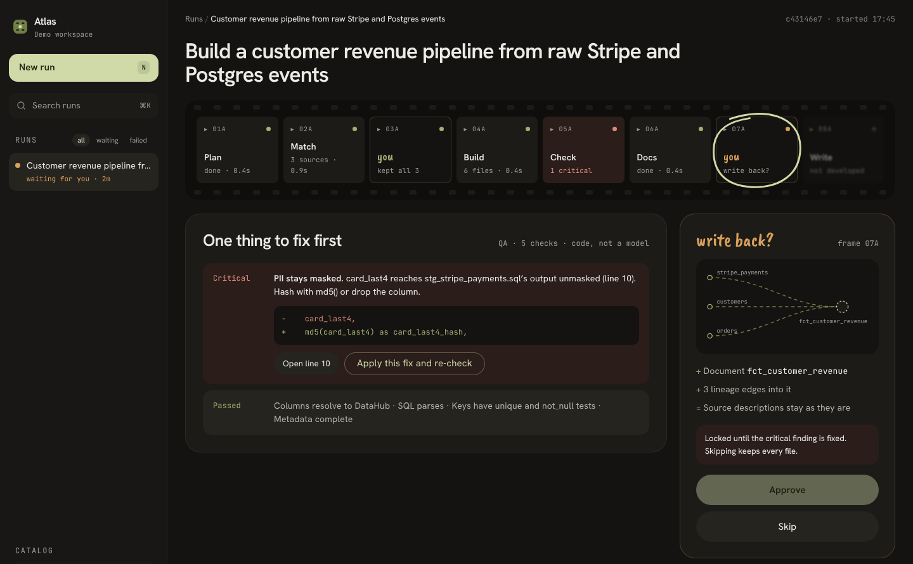
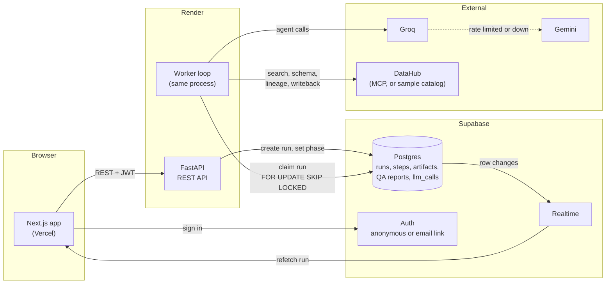

# Atlas

Atlas turns a request like *"customer revenue from Stripe and Postgres events"* into dbt models, tests and docs, written against the real columns in your DataHub catalog and checked by code before anything is written back.



**[Live demo](https://atlas-ai-taupe.vercel.app)** (no sign-up: "Try the demo" gives you a private workspace with a sample catalog) · [Decision records](docs/decisions) · [Deploy guide](docs/deploy.md)

The API runs on Render's free plan and sleeps when idle, so the first request after a quiet spell takes about a minute.

## The problem

An LLM will write a dbt model for any request. It will also invent a `country` column that no source has, pass a customer's email straight through to a mart, and sound equally sure either way. A data engineer then has to read every line to find out which parts are real, and that review takes longer than writing the model.

## What it does

- **Finds the sources first.** It searches DataHub for datasets that match the request and shows you what it found, with PII columns marked. Nothing is generated until you keep the sources or start fresh.
- **Writes a full dbt change:** staging models, a mart, tests and a data dictionary, all built from the schemas DataHub returned.
- **Checks the SQL with code, not a model.** Every column is resolved through CTEs and aliases back to a catalog table. Unknown columns and unmasked PII block the run. An unmasked column usually comes with a one-line fix you can apply and re-check.
- **Asks before it writes back.** Documentation and lineage go to DataHub only after a second approval, and only if QA has nothing critical.
- **Shows its work live.** Each step, retry and provider fallback appears in the run log as it happens. A failed step can be retried on its own.

## How it works



1. Creating a run stores it with `phase = context`. It doesn't run inside the request.
2. A worker claims the run with `FOR UPDATE SKIP LOCKED` and holds a 60-second lease, renewed while it works. It runs the planner, then the metadata analyst, which searches DataHub.
3. The run stops at the first checkpoint. Keeping the sources (or starting fresh) queues the next phase: data engineer, QA, documentation.
4. QA parses every model with sqlglot and resolves each column against DataHub's schemas. A critical finding locks writeback until it's fixed.
5. Approving writeback queues the last phase, which writes docs and lineage to DataHub.

The browser never holds a socket to the API. Supabase Realtime tells it a row changed, and it refetches the run. Without Supabase (local development), it polls.

## Engineering decisions

Each one has a full record in [`docs/decisions`](docs/decisions).

- **A Postgres-backed worker, not background tasks.** FastAPI's background tasks die with the process, and the free host restarts often. A run is a row with a `phase`, and a lease means a crashed run resumes from its last finished step on the next claim. A queue service would add a second thing to host for no gain at this volume. ([ADR 001](docs/decisions/001-durable-run-execution.md))
- **Realtime from the database, not WebSockets from the API.** The worker already writes every step to Postgres, so Supabase Realtime streams those changes, and the API stays stateless. ([ADR 003](docs/decisions/003-realtime-via-supabase.md))
- **A deterministic QA check, not an LLM judge.** A judge can pass the same file on one run and fail it on the next. sqlglot resolves columns the same way every time, so a QA verdict can be tested and trusted. ([ADR 005](docs/decisions/005-qa-grounding-with-sqlglot.md))
- **Two free providers behind one httpx client, no framework.** The pipeline is four fixed calls with structured output. A provider chain with fallback on 429, 5xx and timeouts is about 200 lines, and every call is logged with tokens, latency and outcome. ([ADR 004](docs/decisions/004-llm-provider-chain.md))
- **Three hosts on free plans.** Vercel for the web app, Render for the long-running API and worker, and Supabase for the database, auth and realtime. Each one does what the others can't on a free plan. ([ADR 007](docs/decisions/007-backend-hosting.md))

## Evals

[`apps/api/evals`](apps/api/evals) runs 26 requests against the sample catalog, each once grounded and once started fresh:

- 10 the catalog can answer;
- 8 that ask for columns that don't exist;
- 5 that invite a PII leak;
- 3 the catalog can't answer at all.

Every generated model is then checked against the full catalog with the same code QA uses.

It reports:
- the share of runs that use a column the catalog doesn't have;
- the share that leak PII;
- the share QA blocks;
- false source matches on unanswerable requests;
- latency and tokens per run.

It runs on demand from GitHub Actions. The first baseline on the live providers is pending.

## Tech stack

- **Frontend:** Next.js 16, React 19, TypeScript, Tailwind v4. Fonts are self-hosted, and the landing page animations are CSS only. Lighthouse on mobile: performance 87, accessibility 100.
- **Backend:** FastAPI with async SQLAlchemy and asyncpg. One process serves the API and runs the worker.
- **Data:** Supabase Postgres with row-level security, so clients read only their own workspace. The API writes with the service role.
- **AI:** Groq (`openai/gpt-oss-120b`) with Gemini Flash-Lite as fallback, both on free tiers. sqlglot does the QA.
- **Catalog:** DataHub through `mcp-server-datahub`. Without a DataHub URL, a seeded sample catalog stands in.
- **Infra:** Vercel, Render (Docker), Supabase. GitHub Actions runs CI, and a deploy workflow applies migrations, deploys, then runs a smoke test.

## Run locally

You need Docker, or Python 3.12, Node 22 and Postgres 16.

```bash
docker compose up --build
```

Open http://localhost:3000. This runs in demo mode with no sign-in: fixture LLM answers and the sample catalog, so no keys are needed. On first start, Postgres applies `supabase/migrations` and the seed.

Without Docker:

```bash
# API and worker (needs a Postgres database called atlas)
cd apps/api
python3.12 -m venv .venv && source .venv/bin/activate
pip install -e ".[dev]"
cp .env.example .env        # set AUTH_MODE=off for local use
uvicorn app.main:app --reload

# Web, in another terminal
cd apps/web
npm install
cp .env.example .env.local  # leave the Supabase values blank to skip sign-in
npm run dev
```

**Real models:**
- Set `DEMO_MODE=false` and add `GROQ_API_KEY`, `GEMINI_API_KEY` or both to `apps/api/.env`.

**Real DataHub:**
- Set `DATAHUB_GMS_URL` (and `DATAHUB_TOKEN` if auth is on).
- Then `pip install mcp-server-datahub`.
- `python scripts/inspect_mcp_tools.py` prints the tool schemas Atlas calls.

**Tests:**
```bash
cd apps/api && pytest -q     # needs a Postgres database called atlas_test (TEST_DATABASE_URL)
```

Hosting it yourself: [docs/deploy.md](docs/deploy.md).

## Limitations

- **One DataHub connection per deployment.** The `datahub_connections` table exists, but there's no UI yet to connect your own instance, so the live demo uses the sample catalog.
- **QA reads SQL statically.** Macros and loops beyond `ref()` and `source()` are reported as unverifiable, not checked. Running models on DuckDB with sample rows would prove more.
- **Documentation isn't regenerated after a fix.** It keeps the old column name until the next run.
- **Free tiers set the ceiling.** Ten runs per hour per user, and a cold start of about a minute on the API.

## Author

Built by Elisabeth Nnamani · [elisabethnnamani.dev](https://elisabethnnamani.dev) · [GitHub](https://github.com/Elisabeth56)

Apache 2.0, see [LICENSE](LICENSE).
